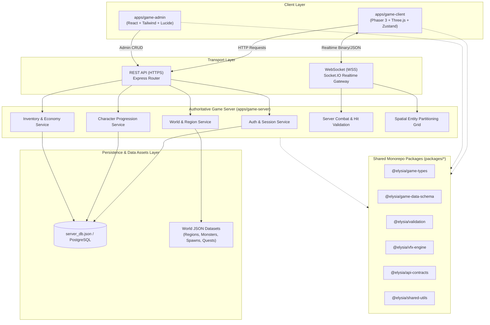
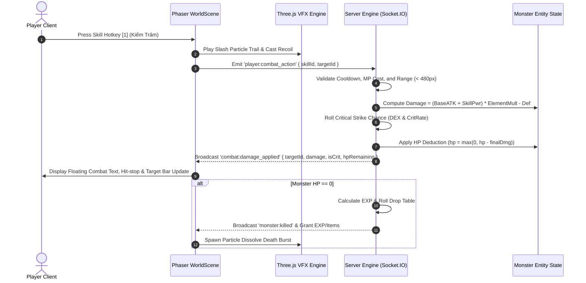

# ELYSIA NO DENSETSU – SYSTEM ARCHITECTURE SPECIFICATION
## High-Performance Browser MMORPG Engine

### Document Version: 1.0.0
### Classification: Technical Blueprint & Architectural Standard

---

## 1. Architectural Overview & System Topology

`ELYSIA NO DENSETSU` adopts a **data-driven, server-authoritative client-server architecture** organized within a modular **pnpm monorepo**.

---

## 2. Monorepo Structure & Package Dependencies

The monorepo enforces single-source-of-truth types and validation across frontends and backends:

| Package / App | Purpose | Main Dependencies |
|---|---|---|
| `apps/game-client` | WebGL/Canvas game runtime, HUD, audio, camera, client interpolation. | `phaser`, `three`, `socket.io-client`, shared packages. |
| `apps/game-admin` | Web-based GM console, item editor, VFX sandbox, paperdoll viewer. | `react`, `react-dom`, `vite`, `lucide-react`, shared packages. |
| `apps/game-server` | Authoritative world state, collision, combat rules, persistence. | `express`, `socket.io`, `bcryptjs`, `jsonwebtoken`, shared packages. |
| `packages/game-types` | Pure TypeScript interfaces (entities, items, stats, combat types). | None (zero dependency). |
| `packages/game-data-schema` | Static definitions for classes, starter skills, baseline attributes. | `@elysia/game-types`. |
| `packages/validation` | Name validators, stat distribution bounds, payload validators. | `@elysia/game-types`. |
| `packages/vfx-engine` | Three.js particle systems, shaders, hit-stop, camera shake. | `three`, `@elysia/game-types`. |
| `packages/api-contracts` | DTOs and API response models for client and server. | `@elysia/game-types`. |
| `packages/shared-utils` | Combat power, damage formula, drop rate roll algorithms. | `@elysia/game-types`. |

---

## 3. Client Engine: Dual-Layer Rendering (Phaser 3 + Three.js)

To achieve the visual quality of modern Japanese MMORPGs, the game client employs a **synchronized dual-canvas architecture**:

1. **Phaser 3 Canvas (Lower Layer - 2D):**
   - Handles tilemap rendering, ground shadows, 2D chibi character sprites, monster animations, depth sorting (`depth = y`), and 2D physics collision boxes.
   - Operates in `Phaser.Scale.RESIZE` mode to dynamically fill all desktop and mobile viewports.
2. **Three.js WebGL Canvas (Upper Layer - 3D/VFX):**
   - Positioned directly over the Phaser canvas with transparent background (`alpha: true`).
   - Driven directly by the Phaser scene `update(time, delta)` loop.
   - Synchronizes its orthographic camera position, viewport width/height, and zoom factor with Phaser's `cameras.main`.
   - Renders high-particle-count particle bursts, elemental rings, shockwaves, slash trails, and bloom lighting without stalling 2D sprite draw calls.
3. **HTML5 Master HUD (Top Layer - DOM/CSS):**
   - Hardware-accelerated CSS glassmorphism overlay containing status globes, skill hotbars, quest trackers, minimap canvas, and dialog modals.

---

## 4. Server-Authoritative Realtime Networking

All gameplay state is authoritative on the server. The client transmits user inputs (intent), while the server validates rules, broadcasts changes, and persists progression.

### 4.1 Spatial Partitioning
The world is partitioned into distinct `regionId` rooms (`VIL_STARTER`, `FIELD_EAST`, etc.). Realtime events (`player:move`, `player:combat_action`) are scoped only to players in the same region, preventing unbounded socket broadcast scaling.

### 4.2 Client Interpolation & State Reconciliation
- **Client Prediction:** The local player responds immediately to movement input keys.
- **Heartbeat & Sync:** Position updates are throttled to 20Hz (every 50ms) during movement and dispatched to the server.
- **Remote Entity Smoothing:** Other players and monsters are interpolated smoothly across frames using linear vector interpolation (`lerp`).

---

## 5. Combat & Damage Calculation Pipeline

The combat system guarantees consistent, deterministic damage across client effects and server logs:

---

## 6. Persistence & Data Storage

- **Development & Offline Environments:** High-speed JSON document store (`apps/game-server/data/server_db.json`) with automated backup snapshots, schema migrations, and atomic writes.
- **Production Architecture:** Seamlessly plugs into PostgreSQL via Prisma ORM for relational persistence of accounts, characters, inventories, and auction logs, supplemented by Redis for live socket session states.
