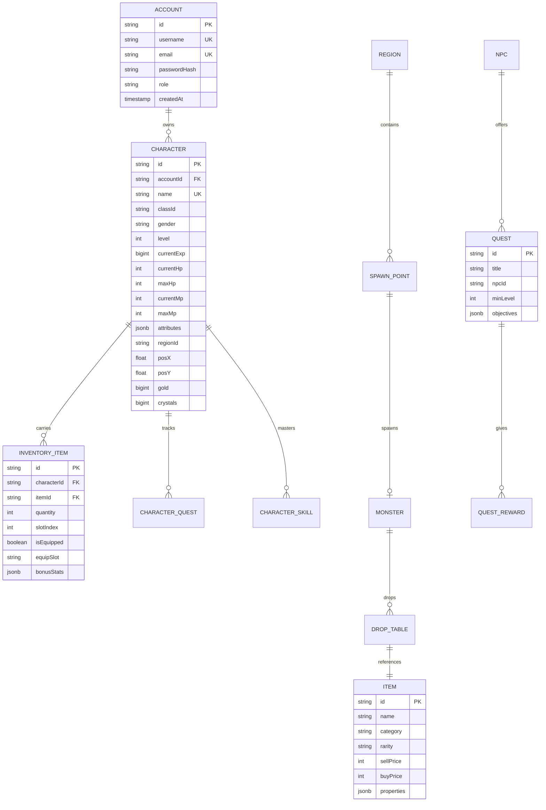

# ELYSIA NO DENSETSU – DATABASE SCHEMA SPECIFICATION
## Storage Architecture, Data Models & Migration Specs

### Document Version: 1.0.0
### Scope: Server Persistent Storage (JSON Document Store / PostgreSQL Schema)

---

## 1. Storage Overview

The game server uses a dual storage paradigm:
1. **Runtime Fast JSON Store:** Lightweight, zero-dependency, atomic document store located in `apps/game-server/data/server_db.json`.
2. **PostgreSQL Relational Schema:** Production-ready schema matching Prisma ORM conventions with strict foreign key constraints, indexes, and ACID guarantees.

---

## 2. Entity Relationship Diagram (ERD)

---

## 3. Detailed Data Models

### 3.1 Account (`accounts`)
Stores player credentials and authorization tier.
- `id` (VARCHAR(36), PK): UUID v4 identifier.
- `username` (VARCHAR(32), UNIQUE, INDEX): Account login handle (3–32 chars, alphanumeric).
- `email` (VARCHAR(255), UNIQUE, INDEX): Verified player email.
- `password_hash` (VARCHAR(255)): Bcrypt salt + hash (10 rounds).
- `role` (VARCHAR(16)): `'player'` or `'admin'`.
- `created_at` (TIMESTAMP): Account registration timestamp.
- `last_login_at` (TIMESTAMP): Most recent authenticated session.

### 3.2 Character (`characters`)
Core player avatar representation in the world.
- `id` (VARCHAR(36), PK): Character unique ID.
- `account_id` (VARCHAR(36), FK -> `accounts.id`): Parent account.
- `name` (VARCHAR(24), UNIQUE, INDEX): Display name (3–20 chars).
- `class_id` (VARCHAR(24)): `'novice'`, `'swordsman'`, `'mage'`, `'archer'`, etc.
- `gender` (VARCHAR(8)): `'male'` or `'female'`.
- `level` (INTEGER): Progression level (1–99). Default `1`.
- `current_exp` (BIGINT): Current experience points. Default `0`.
- `current_hp` / `max_hp` (INTEGER): Vital health points.
- `current_mp` / `max_mp` (INTEGER): Mana / energy points.
- `attributes` (JSONB): Primary stats `{ str: 10, agi: 10, vit: 10, int: 10, dex: 10, luk: 10, unallocated: 0 }`.
- `region_id` (VARCHAR(32)): Current map region (`'VIL_STARTER'`).
- `pos_x` / `pos_y` (FLOAT): Coordinates in world space.
- `gold` (BIGINT): In-game gold balance. Default `500`.
- `crystals` (BIGINT): Premium Elysia Crystal balance. Default `0`.

### 3.3 Item Registry (`items`)
Master catalog of all 57 canonical items.
- `id` (VARCHAR(48), PK): E.g., `'ITEM_SWORD_IRON'`, `'ITEM_POTION_HP_SMALL'`.
- `name` (VARCHAR(100)): Localized item name.
- `category` (VARCHAR(24)): `'weapon'`, `'armor'`, `'potion'`, `'material'`, `'quest'`.
- `rarity` (VARCHAR(16)): `'common'`, `'uncommon'`, `'rare'`, `'epic'`, `'legendary'`.
- `sell_price` (INTEGER): Gold received when sold to NPC.
- `buy_price` (INTEGER): Gold cost in NPC shops.
- `properties` (JSONB): Combat stats (`attackPower`, `defense`, `hpRestore`, etc.).

---

## 4. Database Migrations & Seeding Strategy

The server initialization sequence executes migrations in order:
1. **Migration 001 - Init Schema:** Creates tables or JSON collections for `accounts`, `characters`, `items`, `inventory`, `quests`.
2. **Migration 002 - Seed Super Admin:** Ensures root administrator `admin / admin123` exists.
3. **Migration 003 - Seed Starter Character:** Seeds test account `player / player123` with starter Novice `Airi_Kurogane`.
4. **Migration 004 - Sync World Items:** Ingests all 57 canonical items from `world_items.json` into the items table.
