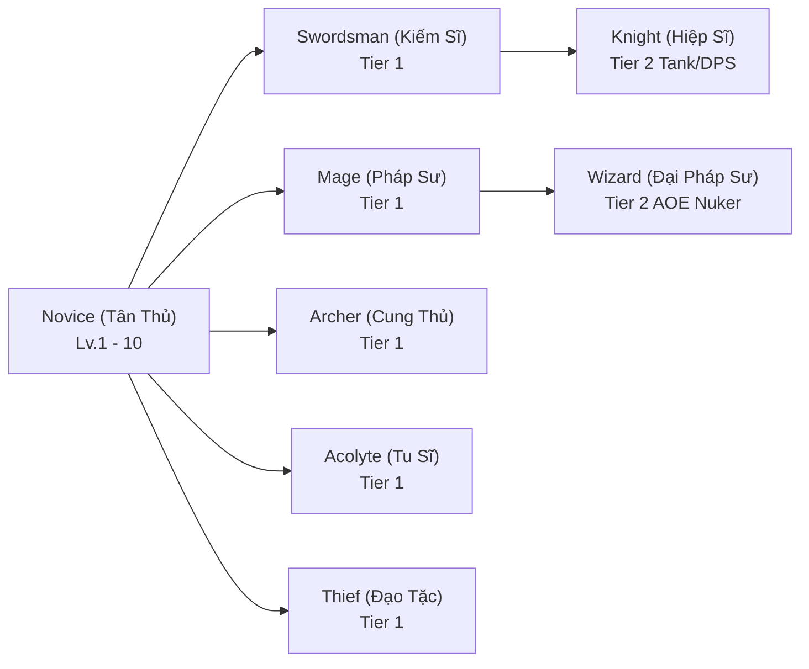

# ELYSIA NO DENSETSU – ELYSIA FRONTIER
## MASTER GAME DESIGN DOCUMENT (GDD)

### Document Version: 1.0.0
### Product Lead: Senior MMORPG Systems Designer

---

## 1. Executive Summary & Vision

- **Title:** ELYSIA NO DENSETSU: Elysia Frontier
- **Genre:** 2D Browser Anime MMORPG
- **Target Platform:** HTML5 Desktop Browser First, Mobile Responsive Compatible
- **Core Loop:** Explore Open Frontier Regions → Slay Thematic Monsters → Collect Materials & Rare Equipment → Progress Level & Job Tier → Complete Lore Quests → Form Guilds & Engage in World Boss Raids.
- **Pillars of Design:**
  1. *Fluid & Tactile Combat:* Responsive 8-direction movement, animation cancelable dashes, impactful screen shakes, hit-stops, and floating combat numbers.
  2. *Rich Class Specialization:* Start as a Novice, advance into one of 4 First Jobs, and ascend into elite Second Jobs with branching skill synergies.
  3. *Interconnected Living World:* Seamless region transitions from peaceful starter villages to dangerous frontier wilderness, populated by active patrolling fauna and quest-giving NPCs.

---

## 2. World Structure & Regional Progression

The continent of Elysia is divided into 5 distinct beginner-to-intermediate regions:

```
                  [ FIELD_NORTH ]
                 (Lv.14 - 18 Frost/Dark)
                         |
  [ FIELD_WEST ] --- [ VIL_STARTER ] --- [ FIELD_EAST ]
 (Lv.6 - 10 Beast)   (Safe Sanctuary)   (Lv.1 - 5 Flora/Slime)
                         |
                  [ FIELD_SOUTH ]
                 (Lv.10 - 14 Earth/Undead)
```

### 2.1 Regional Specifications

| Region ID | Name | Theme & Element | Level Band | Safe Zone | Spawn Density | Key Landmark |
|---|---|---|---|---|---|---|
| `VIL_STARTER` | Starter Village (Làng Khởi Nguyên) | Neutral / Harmony | 1–5 | **Yes (100% Safe)** | 0 (No hostiles) | Plaza Fountain, Temple of Job Advancement |
| `FIELD_EAST` | Eastern Frontier (Đồng Cỏ Phía Đông) | Flora, Light, Neutral | 1–5 | No | 12 Spawns | Sproutling Clearing, Whispering Stream |
| `FIELD_WEST` | Western Frontier (Rừng Rậm Phía Tây) | Beast, Wind, Wood | 6–10 | No | 8 Spawns | Wolf Den, Ancient Tree Stump |
| `FIELD_SOUTH` | Southern Frontier (Hang Động Phía Nam)| Earth, Rock, Undead | 10–14 | No | 7 Spawns | Abandoned Mine Shaft, Obsidian Crags |
| `FIELD_NORTH` | Northern Frontier (Cao Nguyên Phía Bắc)| Ice, Dark, Lightning | 14–18 | No | 6 Spawns | Frozen Ridge, Dragon Tooth Peak |

---

## 3. Class System & Job Tree Progression

Characters begin as **Novices** with fundamental survival skills, advancing at Level 10 upon visiting the **Temple of Job Advancement** in Starter Village.



### 3.1 Class Stat Archetypes & Combat Scaling

| Class ID | Role | Primary Stat | Secondary Stat | Key Strengths |
|---|---|---|---|---|
| `novice` | Generalist Starter | All Balanced | All Balanced | Fast attack animation, low equipment requirement. |
| `swordsman` | Melee Brawler | STR | VIT | High physical burst, sustained cleave, durable HP. |
| `mage` | Ranged Caster | INT | DEX | Extreme elemental magic burst, wide AOE spells. |
| `archer` | Precision Ranged | DEX | AGI | Highest single-target DPS from distance, high crit rate. |
| `acolyte` | Divine Support | INT | VIT | Powerful heals, divine protective barriers, party buffs. |
| `thief` | Stealth Assassin | AGI | DEX | High evasion, poison strikes, high critical multiplier. |
| `knight` | Heavy Vanguard | VIT | STR | Supreme physical/magical defense, crowd control. |
| `wizard` | Elemental Overlord | INT | DEX | Screen-clearing blizzard, meteor storms, chain lightning. |

---

## 4. Attributes & Mathematical Formulas

Every character has 6 primary attributes, customizable upon leveling up (5 stat points per level):

1. **STR (Strength):** Increases Physical Attack (`P.ATK = STR * 2.2 + Level * 1.5`) and inventory weight capacity.
2. **AGI (Agility):** Increases Attack Speed and Evasion Rate (`Flee = AGI * 1.2 + DEX * 0.4`).
3. **VIT (Vitality):** Increases Max HP (`MaxHP = BaseHP + VIT * 18 + Level * 22`) and Physical Defense (`P.DEF = VIT * 1.4`).
4. **INT (Intelligence):** Increases Magic Attack (`M.ATK = INT * 2.5 + Level * 1.2`), Max MP (`MaxMP = BaseMP + INT * 12`), and Magic Defense (`M.DEF = INT * 1.2`).
5. **DEX (Dexterity):** Increases Hit Accuracy, Ranged Weapon Damage, and Critical Strike Chance (`Crit% = DEX * 0.15 + Level * 0.05`).
6. **LUK (Luck):** Increases Rare Drop Multiplier, Critical Damage (`CritDmg% = 150% + LUK * 0.3%`), and Status Resistance.

### 4.1 Damage Formula

$$\text{Final Damage} = \max\left(1, (\text{Effective Attack} \times \text{Skill Multiplier} - \text{Target Defense}) \times \text{Elemental Modifier}\right) \times (\text{isCrit} ? \text{CritMultiplier} : 1.0)$$

Where:
- **Elemental Modifier:** $1.5\times$ for advantageous elements (e.g., Fire vs Flora), $0.75\times$ for resistant, $1.0\times$ for neutral.
- **Random Variance:** Standard $\pm 5\%$ damage spread on non-critical hits.

---

## 5. Monster Progression & Ecology

A total of 32 fully-stat'd monsters inhabit the frontier, categorized across 5 elemental types:

- **Flora & Slimes (Lv.1 - 5, Eastern Frontier):** Slime, Horn Slime, Sproutling, Seed Spitter. Low aggressiveness, dropping crafting fibers, slime jellies, and beginner wooden swords.
- **Beasts & Avians (Lv.6 - 10, Western Frontier):** Forest Boar, Thorn Wolf, Dire Badger, Hawk Harrier. Aggressive pack behavior, dropping hides, fangs, and bronze armors.
- **Undead & Burrowers (Lv.10 - 14, Southern Frontier):** Cave Bat, Skeleton Miner, Obsidian Beetle, Ghoul. Moderate magic resistance, high physical attack, dropping iron ores and bone relics.
- **Frost & Dark Beasts (Lv.14 - 18, Northern Frontier):** Frost Drake, Glacial Wisp, Shadow Stalker, Yeti Chieftain. Uses freeze debuffs and heavy charge attacks.

---

## 6. Economy, Equipment & Loot System

### 6.1 Equipment Tiers & Item Rarities
1. **Common (Trắng - 1.0x Stats):** Standard baseline gear purchased from village blacksmith.
2. **Uncommon (Xanh Lục - 1.2x Stats):** Gear with 1 minor bonus stat rolled from frontier monsters.
3. **Rare (Xanh Lam - 1.5x Stats):** Gear with 2 secondary bonus stats and weapon paperdoll glow.
4. **Epic (Tím - 1.9x Stats):** Regional boss drops with unique passive procs.
5. **Legendary (Cam / Vàng Hoàng Gia - 2.5x Stats):** Mythic tier artifacts like the *Holy Blade Excalibur*.

### 6.2 Currencies
- **Gold (Vàng):** Standard in-game currency earned from quests, monster bounties, and merchant sales.
- **Elysia Crystal (Pha Lê Elysia):** Premium / achievement currency used for cosmetic hair styles, skin tones, and title effects.
