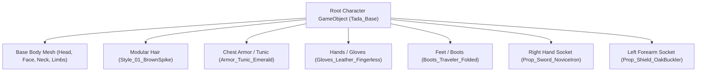

# MASTER 3D CHARACTER DESIGN SPECIFICATION
## "TADA" – THE NOVICE ADVENTURER
### Japanese & Classic Asian Anime Chibi Fantasy MMORPG Standard


## 🌟 MASTER 3D MODEL & TURNAROUND REFERENCE SHEET


---

## 1. CHARACTER PROFILE & VISUAL IDENTITY

- **Name:** Tada (Đa Đa)
- **Class / Job Tier:** Novice Adventurer (Tân Thủ Khởi Hành) / Lv. 12
- **Origin:** Peaceful Riverside Village (Làng Bình Yên / Elysia Frontier)
- **Art Direction Style:**
  - **Proportion Core:** 2.8-Head Anime Chibi proportion.
  - **Visual DNA:** Fusion of classic 2.5D Asian MMORPG aesthetic (*TS Online, MapleStory, RO, Genshin Impact Chibi*) with modern hand-painted stylized 3D rendering.
  - **Palette Harmony:** Forest Emerald Green (`#2d7a4b`), Toasted Almond Tan (`#dfd3b8`), Warm Saddle Leather (`#6f4325`), Aged Brass Trim (`#d8a83d`), Polished River Steel (`#cad5e2`).

---

## 2. ANATOMY & PROPORTION ARCHITECTURE (2.8 HEADS)

```
        ▲ 0.0H  --- Top of styled hair
        │       [ Head & Face: 1.0H ]
        │       - Eye width: 32% of face width
        ▼ 1.0H  --- Chin & neck junction
        ▲       [ Torso & Pelvis: 0.9H ]
        │       - Shoulder span: 1.25x head width
        │       - High waistline with belt at 1.45H
        ▼ 1.9H  --- Inseam / hip pivot
        ▲       [ Legs & Boots: 0.9H ]
        │       - Compact sturdy legs with oversized boots
        ▼ 2.8H  --- Soles of boots on ground plane
```

### 2.1 Isometric Camera Readability
Because the primary game perspective is an **isometric $45^\circ$ tilt**, key silhouettes are exaggerated:
- **Head & Hair:** Hair clusters are sculpted with distinct directional flow and primary chunky shapes so the character's facing direction is immediately clear from high camera angles.
- **Shoulders & Hands:** Gloves and weapon hilts are scaled up by $15\text{–}20\%$ relative to realistic human anatomy to ensure clean attack readability.
- **Boots & Ground Footing:** Wide, grounded boot soles ensure the character feels anchored to the tilemap terrain.

---

## 3. MODULAR EQUIPMENT & MATERIAL SEPARATION

The 3D model is designed in **separable modular mesh groups** to support runtime equipment swapping in Unity 6:



### 3.1 Material & Texture Specifications

| Component | Material Type | Texture Maps | Key Visual Properties |
|---|---|---|---|
| **Skin & Face** | Stylized Toon Skin | Albedo + SSS Ramp + Face Blendshapes | Soft blush, hand-painted anime eyelid highlights, expressive anime eyes. |
| **Hair** | Anisotropic Toon Hair | Albedo + Normal + Specular Band Mask | Chunky strand clumps, radial gradient from root to tip, stylized rim specular. |
| **Cloth / Tunic** | Rough Linen Fabric | Albedo + Ambient Occlusion + Curvature | Subtle cross-hatch hand-painted weave, cream edge trims with clean piping. |
| **Armor / Belts** | Oiled Saddle Leather | Albedo + Specular Gloss + Normal | Beveled stitch borders, worn surface scratches, matte specular highlights. |
| **Metals (Buckles, Blade)** | Stylized Hand-painted Metal | Albedo + Metalness + Roughness | Non-photorealistic metal, baked environmental gradient, edge highlights. |
| **Shield (Wood Core)** | Concentric Oak Planks | Albedo + Normal + Dirt Mask | Circular wood grain, central brass boss plate, riveted outer ring. |

---

## 4. 10-POSE CHARACTER REFERENCE MATRIX

The reference sheet encompasses the standard 10 turnaround views and gameplay poses:

### 1. Front View (Neutral Calibration A-Pose)
- **Arms:** Relaxed at $30^\circ$ angle from torso, palms facing forward.
- **Feet:** Shoulder-width apart, weight evenly distributed.
- **Purpose:** Base bind pose for rigging, weight painting, and texture alignment.

### 2. Back View (Silhouette & Back-wear Check)
- **Features:** Shows collar fold, rear belt buckle, sheath strap angle, and hair rear volume.
- **Cape / Quiver Clearance:** Guarantees no interpenetration when back accessories are equipped.

### 3. Left Side Profile
- **Alignment:** $90^\circ$ lateral projection.
- **Checkpoints:** Nose bridge slope, ear elevation, chest-to-spine depth ratio, boot toe curvature.

### 4. Right Side Profile
- **Weapon Arm Side:** Verifies right shoulder strap placement and weapon grip alignment.

### 5. 3/4 Isometric Hero View ($45^\circ$ Azimuth, $-30^\circ$ Elevation)
- **Hero Stance:** Dynamic standing pose holding sword forward with shield raised defensively.
- **Readability:** Validates overall in-game camera appeal.

### 6. Idle Standing Loop (60 Frames @ 30 FPS)
- **Cycle:** Gentle breathing chest expansion, rhythmic head micro-tilt, subtle hair swaying.
- **Weight Shift:** Minor secondary weight shift between left and right feet every 2.0 seconds.

### 7. Walking Pose Cycle (30 Frames @ 30 FPS)
- **Strut:** Energetic, confident adventurer stride with high knee lift.
- **Arms:** Opposite arm-leg rhythmic swing; shield held steady on left flank.

### 8. Running Pose Cycle (20 Frames @ 30 FPS)
- **Body Lean:** Forward torso lean of $14^\circ$.
- **Hair & Belts:** Trailing secondary physics drag on hair tips and belt pouches.

### 9. Basic Attack (Slash Combo Apex Pose)
- **Wind-up (F1–F5):** Torso coils back, sword drawn behind right ear.
- **Release (F6–F9):** High-speed diagonal cleave through camera line, displaying curved translucent weapon trail.
- **Follow-through (F10–F18):** Low recovery stance with shield forward for counter-attack.

### 10. Skill Casting Pose (Spell / Martial Focus)
- **Stance:** Deep martial arts crouch, right hand thrusting sword skyward or channeling mana.
- **Aura:** Ground magic circle ring and upward particle currents around boots.

---

## 5. UNITY 6 TECHNICAL SPECIFICATIONS

### 5.1 Geometry & Budget Guidelines
- **LOD0 (Hero / UI Inspection):** $12,000\text{–}15,000$ triangles (including weapon and shield).
- **LOD1 (Isometric Gameplay View):** $6,000\text{–}8,000$ triangles.
- **LOD2 (Crowd / Mobile Distant View):** $3,000\text{–}4,000$ triangles.

### 5.2 Skeleton & Rigging Standard
- Fully compliant with **Unity 6 Mecanim Humanoid Avatar**:
  - `Hips` -> `Spine` -> `Chest` -> `Neck` -> `Head`
  - `LeftShoulder` -> `LeftUpperArm` -> `LeftLowerArm` -> `LeftHand` (3-finger stylized chibi hand or standard 5-finger).
  - `RightShoulder` -> `RightUpperArm` -> `RightLowerArm` -> `RightHand`
  - `LeftUpperLeg` -> `LeftLowerLeg` -> `LeftFoot` -> `LeftToes`
  - `RightUpperLeg` -> `RightLowerLeg` -> `RightFoot` -> `RightToes`
- **Secondary Spring Bones:**
  - `Hair_Bang_L`, `Hair_Bang_R`, `Hair_Back_01`
  - `Ear_Elf_L`, `Ear_Elf_R`
  - `Tunic_Skirt_Front`, `Tunic_Skirt_Back`
  - `Belt_Pouch_L`, `Belt_Pouch_R`

### 5.3 Shader Setup (Universal Render Pipeline - URP)
- **Shader:** Custom `Universal Render Pipeline / Stylized Toon Lit`.
- **Properties:**
  - `_BaseMap`: $2048 \times 2048$ Hand-painted Diffuse Atlas.
  - `_RampMap`: 1D Cel Shading Gradient (2-step anime shadow ramp).
  - `_OutlineWidth`: $1.8\text{px}$ inverted hull screen-space outline.
  - `_OutlineColor`: Warm dark walnut `#321f14` (never harsh pure black).
