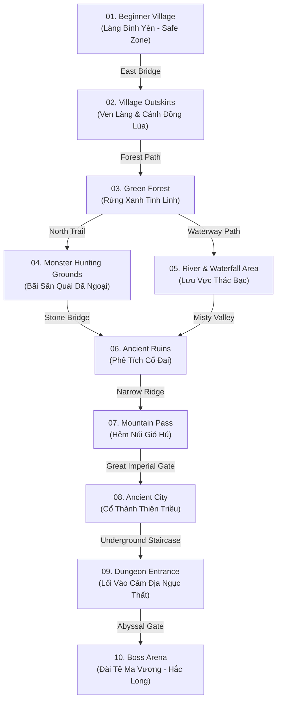
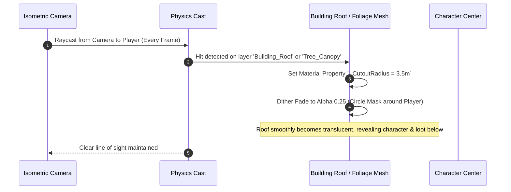
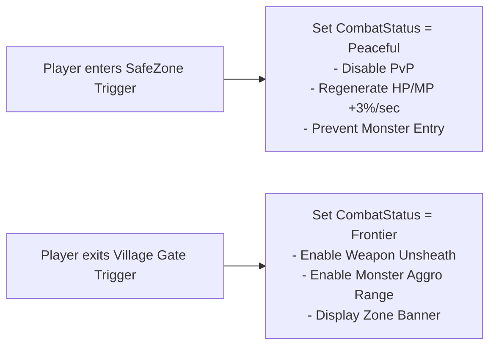

# MASTER 2.5D ISOMETRIC MMORPG WORLD ARCHITECTURE
## "ELYSIA FRONTIER: MIỀN MỘNG" – WORLD SPECIFICATION & UNITY 6 BLUEPRINT

### Document Version: 1.0.0
### Art & Systems Standard: Classic Asian Anime Chibi Fantasy 2.5D Isometric MMORPG

---

## 🌟 MASTER 2.5D ISOMETRIC WORLD ENVIRONMENT SHOWCASE


---

## 1. WORLD TOPOLOGY & 10 INTERCONNECTED REGIONS

The world is structured as a contiguous, seamless open world designed around an **isometric $45^\circ$ diagonal navigation axis**. Players journey from the tranquil sanctuary of the Beginner Village through lush wilderness, ancient ruins, and treacherous peaks into endgame boss domains.



### 1.1 Complete Zone Matrix

| ID | Zone Name | Theme & Atmospheric Identity | Level Band | Safe Zone | Key Landmark & Environmental Storytelling |
|---|---|---|---|---|---|
| **Z01** | **Beginner Village** *(Làng Bình Yên)* | East Asian rural tranquility, timber homes, canals, lanterns | 1–5 | **100% Safe** | Central Plaza, Grand Waterwheel, Tea Pavilion, Blacksmith Forge |
| **Z02** | **Village Outskirts** *(Ven Làng)* | Golden rice paddies, scarecrows, stone bridges, small streams | 3–6 | No | Abandoned Waterwheel, Miller's Granary, Riverside Dock |
| **Z03** | **Green Forest** *(Rừng Xanh)* | Sunlit oak & bamboo canopy, mossy boulders, fireflies | 6–10 | No | Elder Sproutling Tree, Fairy Mushroom Ring, Woodcutter Camp |
| **Z04** | **Hunting Grounds** *(Bãi Săn Quái)* | Open grassy savanna, dirt trails, hunting camps | 10–14 | No | Trapper's Outpost, Boar Wall, Totem Poles |
| **Z05** | **River & Waterfall** *(Thác Bạc)* | Crystal streams, roaring cascading falls, misty water lilies | 12–16 | No | Silver Falls Basin, Fisherman's Pier, Submerged Stone Steps |
| **Z06** | **Ancient Ruins** *(Phế Tích Cổ)* | Broken carved stone pillars, overgrown vines, sundials | 16–20 | No | Celestial Altar, Fallen Dragon Statue, Forgotten Stela |
| **Z07** | **Mountain Pass** *(Hẻm Núi Gió)* | Sheer granite cliffs, rickety suspension bridges, gusty winds | 20–25 | No | Eagle's Eyrie, Crag Watchtower, Dragon Tooth Arch |
| **Z08** | **Ancient City** *(Cổ Thành)* | Grand imperial pagodas, flagstone boulevards, red banners | 25–30 | Partial Safe | Imperial Guard Barracks, Grand Market, Job Mastery Palace |
| **Z09** | **Dungeon Entrance** *(Lối Vào Ngục)* | Ominous obsidian crags, glowing purple runes, chains | 30–35 | No | Sealed Nether Portal, Broken Iron Portcullis, Bone Piles |
| **Z10** | **Boss Arena** *(Đài Tế Ma Vương)* | Floating fractured stone plaza surrounded by volcanic abyss | 35+ | No | Nether Dragon Binding Pillars, Central Ritual Glyph |

---

## 2. ZONE 01 DEEP DIVE: BEGINNER VILLAGE (LÀNG BÌNH YÊN)

The Beginner Village is the emotional anchor of the game, designed to feel welcoming, nostalgic, and bustling with life.

```
+-----------------------------------------------------------------------------------+
|                           [ NORTH MOUNTAIN CLIFFS ]                               |
|                                                                                   |
|  [08. Village Chief Manor]             [09. Job Advancement Pavilion]            |
|       (Dinh Trưởng Làng)                     (Điện Chuyển Chức)                  |
|               \                                       /                           |
|                \===== STONE-PAVED PROMENADE =========/                            |
|               /                                       \                           |
|  [05. Alchemist Hut]      [01. CENTRAL PLAZA FOUNTAIN]    [06. Blacksmith Forge] |
|   (Tiệm Dược Liệu)        - Player Spawn Point & Stelae   (Lò Rèn Thiết Binh)    |
|             |             - Street Lanterns & Benches               |             |
|             |                         |                             |             |
|  [04. Village Tea Shop]   [02. MAIN STONE ARCH BRIDGE]    [07. Training Grounds]  |
|   (Quán Trà Ô Long)        (Cầu Đá Bắt Qua Kênh Nước)     (Bãi Tập Võ Dummy)      |
|             \                         |                             /             |
|              \=== CANAL WITH WATER LILIES & KOI ====/                             |
|                           [03. GIANT WATERWHEEL]                                  |
|                                       |                                           |
|       [10. Open-Air Market]           |              [11. Golden Rice Fields]     |
|       - Potion & Fruit Stalls         |              - Scarecrows & Dirt Paths    |
|                                       ▼                                           |
|                           --> TO ZONE 02: OUTSKIRTS -->                           |
+-----------------------------------------------------------------------------------+
```

### 2.1 Key Buildings & Functional Locations

1. **Central Plaza Fountain (Đài Phun Nước Trung Tâm):**
   - The primary player spawn and resurrection point. Carved from pale grey river stone with celestial lotus engravings.
   - Surrounded by four brass oil lanterns that automatically illuminate at in-game dusk.
2. **Main Stone Arch Bridge (Cầu Đá Kênh Nước):**
   - A $4\text{m}$-wide arched flagstone bridge with weathered timber handrails spanning the village canal.
   - Designed at a clear $45^\circ$ diagonal angle matching the camera axis for optimal character visibility.
3. **Giant Wooden Waterwheel & Canal (Cối Xay Nước & Kênh Đào):**
   - Continuously rotating waterwheel powered by river flow, driving grain mill gears inside the adjoining miller's house.
   - Canal features animated floating pink water lilies (*Nelumbo nucifera*), swimming golden carp (*Koi*), and shallow water shader caustics.
4. **Rustic Tea House & Pavilions (Quán Trà Ô Long):**
   - Open-air wooden timber veranda with bamboo blinds, clay tea urns, and low tables where elder NPCs (e.g., Cụ Tam) dispense tutorial quests.
5. **Blacksmith Forge (Lò Rèn Bác Thiết):**
   - Stone-walled furnace with glowing hot embers, oversized anvil, cooling water trough, and weapon racks displaying Novice Wooden & Bronze Swords.
6. **Alchemist Garden & Apothecary (Tiệm Thuốc Thảo Mộc):**
   - Hanging dried mountain herbs from roof eaves, glazed ceramic medicine pots, and an exterior herb nursery bed.
7. **Training Grounds (Võ Đài Tân Thủ):**
   - Compact sand-floored sparring arena equipped with 3 durable wooden training dummies for players to test attack animations and skill combos.
8. **Village Outskirts Transition Gate (Cổng Ven Làng):**
   - Open wooden gateway decorated with talismans, transitioning smoothly into the golden rice paddies and open monster fields of Zone 02.

---

## 3. 2.5D ISOMETRIC CAMERA MATHEMATICS & SPECIFICATION

To guarantee true isometric harmony without distortion or blind spots, the camera strictly adheres to **true dimetric / isometric standards**:

$$\text{Camera Yaw (Horizontal Azimuth)} = 45.0^\circ$$
$$\text{Camera Pitch (Vertical Elevation)} = 30.0^\circ \quad (\text{or } 35.264^\circ \text{ True Isometric})$$
$$\text{Camera Projection} = \text{Orthographic or Low-FOV Perspective } (15^\circ\text{ FOV at distance})$$

```
                   Camera Position [Eye]
                         \
                          \  Elevation: 30°
                           \
                            ▼
     [World Terrain Plane] ──────────────── Character [Pivot (X, Y, Z)]
                                  ◄─── Azimuth: 45° ───►
```

### 3.1 Occlusion Prevention & Roof Cutout System
In isometric RPGs, tall buildings and dense trees can block the player's view of their character, monsters, or loot. The environment uses an **Anti-Occlusion Dithered Cutout Shader System**:



---

## 4. MODULAR 3D ASSET KIT ARCHITECTURE (UNITY 6)

All environment assets are constructed on a strict **$2\text{m} \times 2\text{m}$ grid snap standard** to enable rapid procedural or hand-crafted level assembly:

```
  Modular Grid Unit: 2.0m x 2.0m x 0.5m
  +-------+-------+
  | (0,0) | (1,0) |  <-- Seamless tileable terrain & paving blocks
  +-------+-------+
  | (0,1) | (1,1) |
  +-------+-------+
```

### 4.1 Asset Kit Breakdown

| Kit Category | Prefab Asset List | Mesh Triangle Budget | Texture Atlas Allocation |
|---|---|---|---|
| **Terrain & Paving** | `Tile_Cobblestone_2x2`, `Tile_DirtPath_2x2`, `Tile_GrassMound_2x2`, `Tile_RiverBank_Corner`, `Tile_PaddyField_2x2` | 120–300 tris / tile | $2048 \times 2048$ PBR Ground Atlas |
| **Modular Architecture** | `Wall_Timber_2m`, `Wall_Timber_Doorway`, `Wall_Timber_Window`, `Roof_Terracotta_Corner`, `Roof_Terracotta_Straight_2m`, `Pillar_CarvedWood_4m` | 400–1,200 tris / piece | $2048 \times 2048$ Wood & Tile Atlas |
| **Bridges & Canals** | `Bridge_StoneArch_Center`, `Bridge_StoneArch_Ramp`, `Canal_Wall_Stone_4m`, `Waterwheel_WheelMesh`, `Waterwheel_Gears` | 800–2,500 tris | $1024 \times 1024$ Stone & Metal Atlas |
| **Foliage & Nature** | `Tree_WeepingWillow_A/B`, `Tree_PeachBlossom_Pink`, `Bush_RiverFern_Cluster`, `Plant_Lotus_Flower`, `Rock_MossyBoulder_Large` | 500–1,800 tris (with wind vertex animation) | $1024 \times 1024$ Foliage Atlas |
| **Props & Street Life** | `Prop_StreetLantern_Brass`, `Prop_TeaUrn_Stack`, `Prop_MarketStall_Tent`, `Prop_Anvil_ForgeSet`, `Prop_Scarecrow_Straw` | 150–600 tris | $1024 \times 1024$ Props Atlas |

---

## 5. GAMEPLAY NAVIGATION & AI INTEGRATION

### 5.1 NavMesh & Auto-Pathfinding Architecture
To support standard MMORPG **Auto-Questing, Auto-Hunting, and Pathfinding**:
- **NavMesh Surface:** Baked into 3 distinct agent types:
  - `HumanoidAgent` (Radius: $0.4\text{m}$, Height: $1.8\text{m}$, Max Slope: $45^\circ$, Step Height: $0.4\text{m}$).
  - `SmallMonsterAgent` (Radius: $0.3\text{m}$, Height: $0.8\text{m}$ for Slimes and Critters).
  - `LargeBossAgent` (Radius: $1.2\text{m}$, Height: $3.5\text{m}$ for World Bosses).
- **Waypoint Navigation Graph:** Central road paths contain hidden spline nodes (`Node_Plaza_01`, `Node_Bridge_East`, etc.) for cinematic quest auto-walking.
- **Water Volumes:** Tagged as `NavMeshArea: Not Walkable` except at designated shallow stepping stone crossings.

### 5.2 Interactive Zones & Trigger Volumes



---

## 6. LIGHTING, SHADERS & PERFORMANCE PROFILE (UNITY 6 URP)

- **Global Illumination:** Pre-baked Directional Lightmaps for static buildings and terrain; realtime dynamic directional sun with warm color temperature ($5200\text{K}$) and soft contact shadows.
- **Stylized Water Shader:** Dual-depth translucent water shader with caustic panning textures, soft shoreline edge foam fading, and reflective surface distortion.
- **Rendering Budget (Target: 60 FPS on Mobile / Desktop WebGL):**
  - **Screen Draw Calls:** $\le 120$ draw calls per frame via GPU Instancing on foliage and terrain tiles.
  - **Total Visible Vertices:** $\le 85,000$ vertices in view frustum.
  - **Texture Memory:** $\le 120\text{ MB}$ total atlas VRAM usage.
